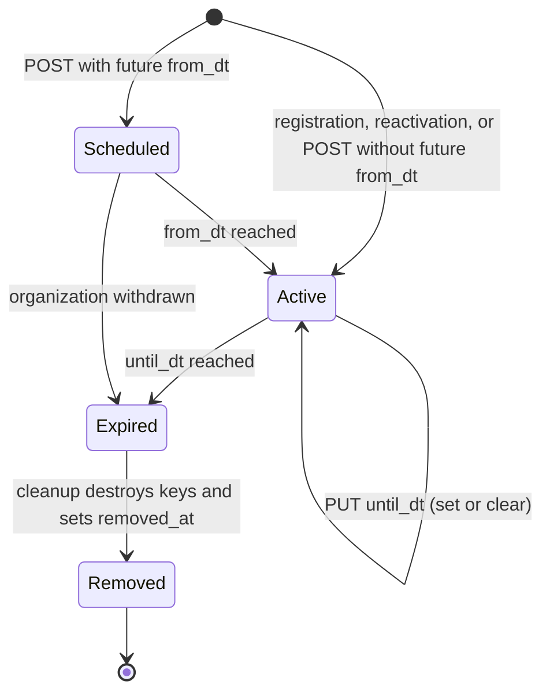

# HSM key versions

Every organization that receives pseudonyms has numbered key versions. A version names the keys in the HSM that the PRS uses for that organization as recipient, so its versions determine every pseudonym and OPRF evaluation made for it. The organization only sees version numbers and dates; the key material stays in the HSM.

Versions live in `prs.hsm_key_versions`: `id`, `organization_id` (references `admin.organizations`), `version`, `from_dt`, `until_dt`, `created_at` and `removed_at`, with one row per organization and version number.

A version is active when `removed_at` is null, `from_dt` is at or before now, and `until_dt` is null or later than now (`app/db/repositories/hsm_key_version_repository.py`).

## Lifecycle



| Transition | Triggered by | Event |
|---|---|---|
| First version created, active | Registration or reactivation of the organization in beheer | none in the PRS |
| New version, active or scheduled | `POST /administration/key-versions` | `KEY_ROTATION_STARTED` |
| Scheduled to active | `from_dt` passes | none |
| End date set or cleared | `PUT /administration/key-versions/{id}` on a version that has not expired | `KEY_GRACE_STARTED` when set, none when cleared |
| Active or scheduled to expired | `until_dt` passes; a withdrawal in beheer sets it to the withdrawal moment | none in the PRS |
| Expired to removed | Cleanup job | `KEY_VERSION_DESTROYED` per destroyed key |

Versions are numbered per OIN. A new version, also the first one of a registration or a reactivation, is one above the highest version of every registration of the OIN, withdrawn ones included, or 0 when there is none.

## Who changes what

| Actor | Changes |
|---|---|
| Beheer (prs-beheer-api) | Creates the first version at registration and a fresh one at reactivation; ends every open version at withdrawal |
| The organization, with scope `prs:administration` | Lists its versions, creates a new one, sets or clears the end date of one that has not expired |
| Cleanup job (`python -m app.cleanup`) | Destroys the keys of expired versions and sets `removed_at` |

There is no `DELETE` route: only the cleanup sets `removed_at`. The administration routes only act on the caller's own organization. See [endpoints.md](endpoints.md#post-administrationkey-versions) for the request and response shapes.

## Dependencies

| Operation | Versions used | HSM labels |
|---|---|---|
| Create a reversible pseudonym | The highest active version | `oin-<oin>-rp-v<n>-aes`, `oin-<oin>-rp-v<n>-hmac` |
| Reverse a reversible pseudonym (`/exchange/personal-id`) | The version inside the pseudonym, which must be active, otherwise `410` | the same |
| Irreversible pseudonym | Every active version: the highest in `subject`, the older ones in `extraVersions` | `oin-<oin>-irp-v<n>-hmac` |
| OPRF evaluation (`/oprf/eval`) | Every active version, in the same way | `oin-<oin>-oprf-v<n>` |

- Keys are created in the HSM on first use per type, with `KEY_GENERATED`. Reversal never creates one.
- A label holds the OIN and the version number, not the organization id. The numbering per OIN keeps two registrations of one OIN apart.
- Every active version costs one HSM call per irreversible or OPRF request.
- Expired versions keep their keys until the cleanup runs, so schedule it ([hsm-key-cleanup.md](hsm-key-cleanup.md)).
- Rotation needs an existing version. Registration in beheer creates the first one for that reason.

## Edge cases

### No active version

Creating a pseudonym or an OPRF evaluation for the organization answers `404` with the unknown-recipient message, on purpose, so a caller cannot tell the two apart. It happens when the old version ends before a scheduled one starts, so end the old version well after the new `from_dt`. The overlap is also the only time receivers can migrate what they stored: only then do exchanges carry the old value in `extraVersions` and can reversible pseudonyms be converted to the new version. Recover with [procedure a](#a-organization-without-an-active-version).

### Rotation without ending the old version

`POST` does not end the old version. Both stay active, so every irreversible and OPRF request costs an extra HSM call and carries `extraVersions` until the old version gets an end date through `PUT`.

### Expired but not removed

Between `until_dt` and the next cleanup run a version is not used, and reversing its pseudonyms answers `410`, although its keys still exist. A passed end date is final: a `PUT` on an expired version answers `409`. The only way back is a new version through `POST`, which gives the organization new pseudonyms, so check an end date on the current version before setting it.

### Cleanup failed halfway

The cleanup destroys the labels of a version one by one and sets `removed_at` after the last one. An HSM error logs `HSM_OPERATION_FAILED` and leaves the version for the next run, possibly with some labels already gone. The run still exits 0. Follow [procedure c](#c-cleanup-failed-for-a-version).

### Organization without any version

An organization registered through prs-beheer-api before v0.1.2, or inserted into the database directly, has no version: beheer creates the first one at registration only since v0.1.2. `POST` then answers `409` and senders get `404`. Follow [procedure b](#b-organization-without-any-version).

### Withdrawn organization

Beheer withdraws an organization by setting `deleted_at` and, in the same transaction, sets `until_dt` to that moment on every open version. The PRS then no longer finds it: its own administration calls get `403` and exchanges to it as recipient get `404`. The next cleanup run destroys its keys. A reactivation in beheer (`PUT` with `deleted: false`) gives the organization a fresh version and so new pseudonyms; reversible pseudonyms from before the withdrawal can no longer be reversed.

### Re-registration of a withdrawn OIN

Beheer accepts a withdrawn OIN again, because the unique index on `external_id` skips withdrawn rows. The first version of the new registration lies above every version of the earlier ones, so it gets its own keys and new pseudonyms, and the cleanup of the old versions never touches them.

### OIN change

The OIN of a registered organization cannot change: beheer answers `409` to `PUT /organizations/{id}` with another OIN. A wrong OIN is fixed by withdrawing the organization and registering the right one. The next cleanup run destroys the old keys, which is harmless before the first exchange and means new pseudonyms after it, so check the OIN at registration.

### Local keys

Without `hsm.url` the PRS derives keys locally. Local OPRF ignores versions and always answers version 1, so a rotation shows no change there, while reversible and irreversible pseudonyms do change per version. The cleanup destroys nothing but still sets `removed_at`.

### Version limit

A reversible pseudonym stores its version in two bytes, so 65535 is the highest version that can create one. Version numbers are never reused within an OIN, removed versions and earlier registrations included.

## Error scenarios

| Status | Endpoint | Cause | Recovery |
|---|---|---|---|
| `403` | `/administration/*` | Organization withdrawn or not registered, or the token lacks `prs:administration` | Reactivate the organization in beheer, or use an administration client |
| `404` | Exchanges and `/oprf/eval` | Recipient has no active version, or is withdrawn | [Procedure a](#a-organization-without-an-active-version), or reactivate it in beheer |
| `404` | `PUT /administration/key-versions/{id}` | The id does not belong to the caller's organization | Take the id from `GET /administration/key-versions` |
| `409` | `POST /administration/key-versions` | The organization has no version at all | [Procedure b](#b-organization-without-any-version) |
| `409` | `PUT /administration/key-versions/{id}` | The version has expired or is removed | None; create a new version, which gives new pseudonyms |
| `410` | `/exchange/personal-id` | The version in the reversible pseudonym is not active | None; convert reversible pseudonyms before their version ends |
| `422` | `POST` and `PUT` on `/administration/key-versions` | `until_dt` not later than now or than the version's `from_dt`, or a date without timezone offset | Correct the dates |
| exit 1 | `python -m app.cleanup` | The run itself failed, logged as `KEY_CLEANUP_FAILED` | Check the log and the database, then run it again |

## Recovery procedures

### a. Organization without an active version

The organization calls `POST /administration/key-versions` without a body. The new version is active at once and its keys are created on the next exchange.

### b. Organization without any version

Run this as database administrator. The number follows the numbering per OIN, so the new version never shares a label with an earlier registration. The new version is active at once.

```sql
INSERT INTO prs.hsm_key_versions (id, organization_id, version, from_dt)
SELECT gen_random_uuid(), '<organization id>', COALESCE(max(v.version) + 1, 0), now()
FROM admin.organizations o
LEFT JOIN prs.hsm_key_versions v ON v.organization_id = o.id
WHERE o.external_id = '<oin, 20 digits>';
```

### c. Cleanup failed for a version

Find `HSM_OPERATION_FAILED` in the cleanup log, fix the HSM problem and run `make cleanup` again. The version stays expired in between.

## Security considerations

- `/administration/*` requires the scope `prs:administration` and only acts on the caller's own organization. Any client of the organization with that scope can end its versions and so stop every exchange to it. Grant the scope to administration clients only.
- Destruction cannot be undone. Reversible pseudonyms under a removed version can never be reversed again.
- A withdrawal ends every version of the organization, and the next cleanup destroys its keys. Beheer refuses a withdrawal while the organization still has active clients.
- Key material never leaves the HSM. The API only exposes version numbers and dates.
- Versions are numbered per OIN, so a re-registered OIN cannot be linked to the pseudonyms of its earlier registration.
- The audit trail consists of `KEY_ROTATION_STARTED`, `KEY_GRACE_STARTED`, `KEY_GENERATED`, `KEY_VERSION_DESTROYED`, `HSM_OPERATION_FAILED` and `KEY_CLEANUP_FAILED` ([log-events.md](log-events.md)). Clearing an end date emits no event.
